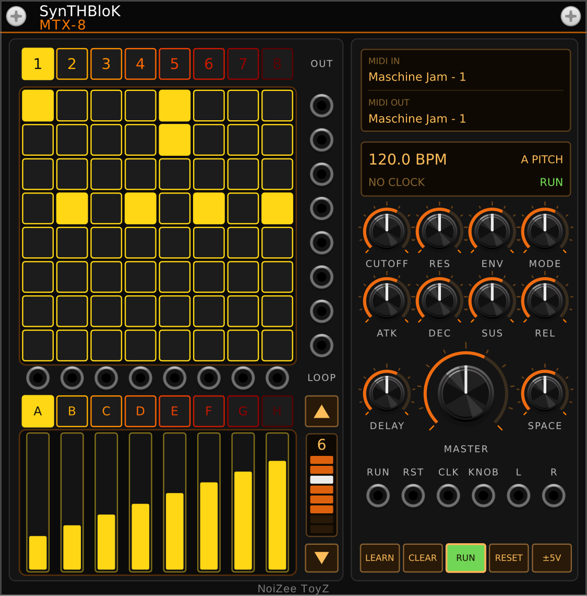

# SynTHBloK MTX-8

A free VCV Rack 2 plugin by **NoiZee ToyZ** (part of the SynTHBloK series).



| Module | What it does |
|---|---|
| **MTX-8** | Maschine JAM groovebox: 8x8 step sequencer driving 8 built-in synth voices (morphing oscillator, resonant filter, envelopes, drive, pan) in a key and scale, random grooves, internal tempo, touch strips shape each voice, stereo out |

## Install

In VCV Rack 2: **Library**, search **SynTHBloK MTX-8**, **Add**.

## Build

```
make RACK_DIR=/path/to/Rack-SDK   # or: make dist / make install
```

## Licence

GPL-3.0-or-later (see `LICENSE.txt`). The SynTHBloK and NoiZee ToyZ names and logos are not covered by the licence.
